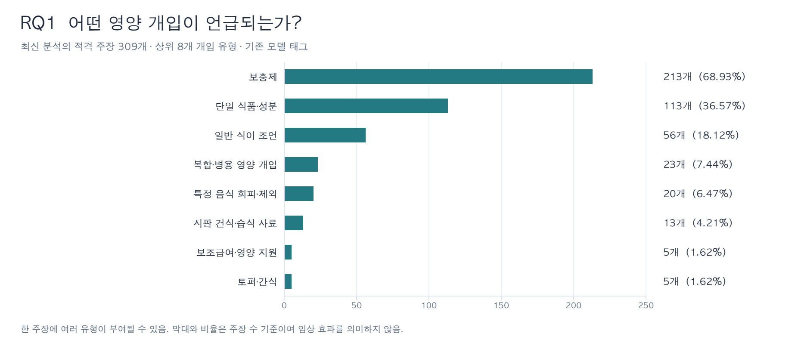
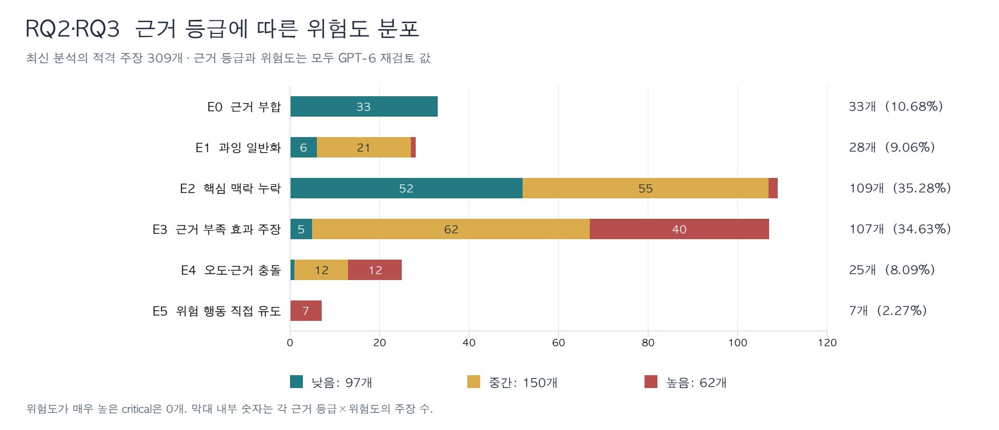
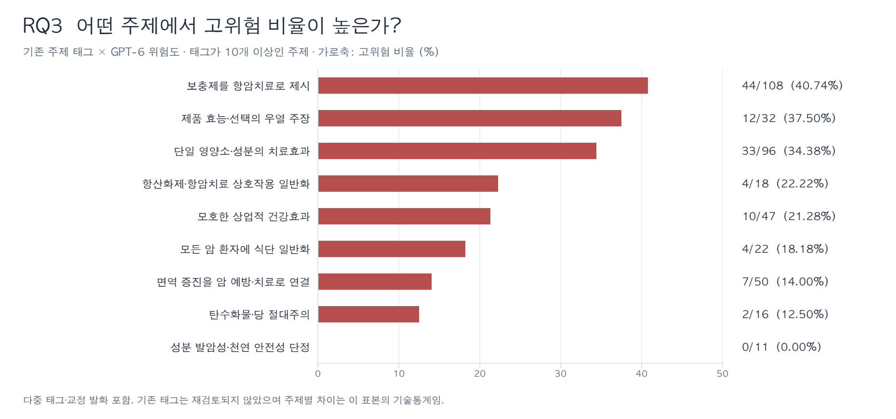

# YouTube 반려동물 종양 영양 주장: RQ1–3 데이터 분석

분석일: **2026-10-25** · 데이터 동결본: **gpt-6-2026-10-21** · 적용 코드북: **v2.2**

## 핵심 결과

주분석은 **49개 영상, 23개 채널, 309개 적격 주장**이다. 434개 재검토 행에서 같은 영상의 이전 분석 이력 34행과 최신 이력의 비적격·불확실 91행을 제외했다. 아래 수치는 저장된 AI 분류·재검토 결과의 기술통계이며, 사람·전문가 합의로 확정된 최종 코딩 결과는 아니다.

| 연구 질문 | 데이터가 보여주는 결과 |
| --- | --- |
| RQ1. 어떤 영양 주장이 나타나는가? | 보충제 213/309 (68.93%), 단일 식품·성분 113/309 (36.57%), 일반 식이 조언 56/309 (18.12%). 개입 유형은 다중 태그. |
| RQ2. 근거와 오해 기제에 따라 어떻게 분류되는가? | E2 핵심 맥락 누락 109/309 (35.28%), E3 근거 부족 효과 주장 107/309 (34.63%). 두 범주 합계 216/309 (69.90%). |
| RQ3. 어떤 유형이 더 높은 잠재적 임상 위험을 가지는가? | 높음 62/309 (20.06%). 고위험 중 보충제 유형 55/62 (88.71%). 보충제 항암치료 주제에서는 44/108 (40.74%)가 고위험. |

고위험 62개 중 **45/62 (72.58%)가 한 채널**에 집중되어 있다. 해당 채널을 제외하면 고위험률은 **17/208 (8.17%)**이다. 따라서 표본 전체의 고위험률을 YouTube 전체의 비율로 일반화할 수 없다.

## 1. 분석 자료와 집계 기준

### 1.1 분석 대상의 구성

| 단계 | 행 수 | 처리 |
| --- | ---: | --- |
| 재검토 데이터 전체 | 434 | 53개 분석 이력, 51개 고유 영상 |
| 이전 분석 이력 제외 | 34 | 동일 영상 2개의 이전 작업 2개 제외 |
| 영상별 최신 완료 이력 | 400 | 51개 영상마다 분석 이력 1개 |
| 같은 이력 내 명시적 중복 제외 | 16 | 재검토의 duplicate 판정 적용 |
| 그 밖의 비적격 행 제외 | 59 | 범위 밖, 비영양 의약품, 단순 서술 등 |
| 불확실 행 제외 | 16 | 핵심 명제·대상·전사 등을 확정할 수 없음 |
| 주분석 | 309 | 적격 주장이 남는 49개 영상, 23개 채널 |

원자료의 모든 적격 행을 합친 337개에는 이전 분석 이력의 적격 주장 28개가 포함된다. **주분석은 309개**, 337개 집계는 민감도 분석으로 제시한다. 영상 간 같은 뜻의 주장은 별도 출현으로 유지한다. 따라서 309는 고유한 의미 명제 수가 아니라 최신 분석 이력에 남은 적격 주장 행 수이다. 같은 영상 내 원문이 완전히 동일한 적격 행의 추가 중복은 없었지만, 의미상 중복 여부를 새로 전수 코딩하지는 않았다.

### 1.2 변수별 출처

| 변수 | 사용한 값 | 해석 범위 |
| --- | --- | --- |
| 주장 적격성·근거 등급·위험도 | review_results.json의 GPT-6 재검토 값 | 이번 분석의 선별 기준과 RQ2·RQ3의 주요 결과 |
| 개입·결과·기전·주제·방향·대상·위험 영역 | input_snapshot.json의 suggested 값 | 원래 gpt-5.6-luna 분류. 이번 GPT-6 재검토의 수정 대상 아님 |
| 최신 이력·수집 경로·전사 완료 상태 | claims_gpt-6.csv | 동결 시점의 내보내기 값 |
| 영상·채널 식별자와 메타데이터 | input_snapshot.json의 원본 값 | CSV의 수식 방지용 앞따옴표를 실제 ID로 오인하지 않도록 원본 JSON 사용 |
| 사람 확정값 | 없음 | 전체 434행 pending_manual_review, reviewed_* 값 없음 |

주제·개입·주장 결과·기전·위험 영역은 **한 주장에 여러 태그를 허용**한다. 각 태그는 한 주장 안에서 1회만 집계하며, 태그별 수와 비율의 합은 309개·100%를 초과할 수 있다. 근거 등급, 위험도, 대상, 방향은 한 주장에 하나의 값이다. 주장 비율의 기본 분모는 309, 영상 출현 비율의 분모는 49, 고위험 구성비의 분모는 62이다. 백분율은 원래 정수에서 계산해 소수 둘째 자리까지 반올림했다. 반올림 때문에 단일값 범주의 비율 합이 100.00%와 조금 다를 수 있다.

이 보고서의 ‘GPT-6’은 저장된 재검토의 식별명이다. 당시 실제 런타임 모델 ID는 `not_exposed_in_session`으로 기록되어 있다. 새로운 모델 호출이나 재코딩 없이 동결된 값을 분석했다.

### 1.3 주분석 표본의 특성

| 항목 | 값 |
| --- | --- |
| 영상·채널·주장 | 49개 · 23개 · 309개 |
| 주장 출처 | 전사문 309/309 (100.00%); 제목·설명·댓글에서 직접 추출된 주장 0개 |
| 영상 수집 경로 | CSV 가져오기 28/49 (57.14%), 직접 URL 21/49 (42.86%) |
| 영상 언어 (기존 분류) | 한국어 47/49 (95.92%), 혼합 2/49 (4.08%) |
| 전체 전사 완료 표시 | 48/49개 영상 (97.96%), 주장 301/309 (97.41%) |
| 저장된 일부 전사만 사용 | 1/49개 영상 (2.04%), 주장 8/309 (2.59%) |
| 영상당 적격 주장 | 중앙값 4, Q1–Q3 3–7, 범위 1–28 |
| 수집 시점 조회수 | 중앙값 2,047, Q1–Q3 815–6,936, 범위 10–326,056 |
| 메타데이터 수집 시점 (UTC) | 2026-07-06 ~ 2026-10-20 |
| 게시·업로드일 필드의 범위 (UTC) | 2018-10-13 ~ 2026-06-14 (출처별 날짜 정의는 동일하지 않을 수 있음) |
| 최소 조회수 필터 | 49개 영상 모두 not_applied |

Q1·Q3는 선형 보간 방식으로 계산했다. 조회수는 서로 다른 날짜에 수집되어 동시점 비교가 아니며, 조회수 가중 주장 수를 계산하지 않았다. 이 폴더는 주장 추출 후의 자료이므로 검색된 전체 영상 수, 검색 순위별 포함률, 추출되지 않은 주장 수는 복원할 수 없다.

## 2. RQ1 — 어떤 영양 관련 주장이 나타나는가?

### 2.1 영양 개입 유형

| 분류 | 주장 수 | 주장 비율 (N=309) | 해당 영상 수 | 영상 비율 (N=49) |
| --- | ---: | ---: | ---: | ---: |
| 보충제 | 213 | 68.93% | 37 | 75.51% |
| 단일 식품·성분 | 113 | 36.57% | 32 | 65.31% |
| 일반 식이 조언 | 56 | 18.12% | 24 | 48.98% |
| 복합·병용 영양 개입 | 23 | 7.44% | 13 | 26.53% |
| 특정 음식 회피·제외 | 20 | 6.47% | 7 | 14.29% |
| 시판 건식·습식 사료 | 13 | 4.21% | 6 | 12.24% |
| 보조급여·영양 지원 | 5 | 1.62% | 5 | 10.20% |
| 토퍼·간식 | 5 | 1.62% | 5 | 10.20% |
| 급여 제한 | 3 | 0.97% | 3 | 6.12% |
| 케톤·저탄수화물 식단 | 3 | 0.97% | 3 | 6.12% |
| 개입 명시 없음 | 3 | 0.97% | 3 | 6.12% |
| 가정 조리식·수제식 | 2 | 0.65% | 2 | 4.08% |
| 시판 조리식·신선식 | 1 | 0.32% | 1 | 2.04% |
| 처방·치료식 | 1 | 0.32% | 1 | 2.04% |
| 생식 | 1 | 0.32% | 1 | 2.04% |
| 불명확 | 1 | 0.32% | 1 | 2.04% |

보충제는 **213/309 (68.93%)**, **37/49개 영상(75.51%)**에 등장한다. 단일 식품·성분 113/309 (36.57%)과 일반 식이 조언 56/309 (18.12%)이 뒤를 잇는다. 보충제와 단일 성분은 함께 부여될 수 있어 두 수를 더해 서로 다른 주장 수로 해석하면 안 된다. 수제식·생식·저탄수화물 식단 등 연구계획서의 다른 관심 주제는 이 동결 자료에서 소수만 포착되었다.

### 2.2 주장에서 다루는 결과

| 분류 | 주장 수 | 주장 비율 (N=309) | 해당 영상 수 | 영상 비율 (N=49) |
| --- | ---: | ---: | ---: | ---: |
| 질환·증상 관리 | 85 | 27.51% | 31 | 63.27% |
| 치료 내약성·치료 중 관리 | 76 | 24.60% | 28 | 57.14% |
| 일반 건강·웰니스 | 65 | 21.04% | 30 | 61.22% |
| 종양 축소 | 61 | 19.74% | 25 | 51.02% |
| 영양 적절성·식품안전 | 52 | 16.83% | 26 | 53.06% |
| 면역 증진 | 49 | 15.86% | 28 | 57.14% |
| 암 예방·위험 감소 | 39 | 12.62% | 19 | 38.78% |
| 신체 상태·신체 기능 | 25 | 8.09% | 10 | 20.41% |
| 삶의 질 | 22 | 7.12% | 13 | 26.53% |
| 염증 감소 | 21 | 6.80% | 12 | 24.49% |
| 생존 | 17 | 5.50% | 11 | 22.45% |
| 악액질 예방 | 13 | 4.21% | 8 | 16.33% |
| 수의학적 치료 대체 | 9 | 2.91% | 8 | 16.33% |
| 식욕 개선 | 6 | 1.94% | 4 | 8.16% |
| 불명확 | 5 | 1.62% | 5 | 10.20% |
| 완치 | 3 | 0.97% | 2 | 4.08% |
| 해독 | 2 | 0.65% | 2 | 4.08% |

질환·증상 관리, 치료 내약성, 일반 건강, 종양 축소가 상위 결과 범주이다. **결과 태그가 붙었다고 그 효과를 긍정하거나 실제 효과가 입증되었다는 뜻은 아니다.** 특히 ‘수의학적 치료 대체’ 태그 9개 중 5개는 기존 방향 코드가 반박·교정이다. 따라서 9개를 모두 치료 대체를 권하는 주장으로 집계할 수 없다.

### 2.3 중립적 영양 주장 기전

| 분류 | 주장 수 | 주장 비율 (N=309) | 해당 영상 수 | 영상 비율 (N=49) |
| --- | ---: | ---: | ---: | ---: |
| 제품 효능·함량·선택 비교 | 84 | 27.18% | 30 | 61.22% |
| 면역·장내미생물 조절 | 79 | 25.57% | 29 | 59.18% |
| 영양 지원·섭취량 관리 | 60 | 19.42% | 27 | 55.10% |
| 항산화·산화스트레스 | 52 | 16.83% | 23 | 46.94% |
| 다량영양소·대사 조절 | 48 | 15.53% | 15 | 30.61% |
| 기타 명시 기전 | 45 | 14.56% | 18 | 36.73% |
| 미량영양소 보충·결핍 | 19 | 6.15% | 8 | 16.33% |
| 식품·성분 안전성·발암성 | 16 | 5.18% | 9 | 18.37% |
| 생식·식품안전 | 1 | 0.32% | 1 | 2.04% |

제품 효능·함량·선택 비교, 면역·장내미생물 조절, 영양 지원·섭취량 관리가 많이 등장한다. 이 표는 무엇을 설명하는지에 대한 내용 분류이며, 기전이 언급되었다는 사실만으로 misinformation으로 분류하지 않는다.

### 2.4 주장 대상·방향·임상 맥락

| 변수 | 분류 | 주장 수 | 비율 (N=309) |
| --- | --- | ---: | ---: |
| 주장 목적 | 암 치료 | 149 | 48.22% |
| 주장 목적 | 지지관리 | 104 | 33.66% |
| 주장 목적 | 암 예방 | 35 | 11.33% |
| 주장 목적 | 일반 건강 | 21 | 6.80% |
| 발화 방향 | 지지·권고 | 219 | 70.87% |
| 발화 방향 | 주의·조건부 | 34 | 11.00% |
| 발화 방향 | 상업적 홍보 | 29 | 9.39% |
| 발화 방향 | 반박·교정 | 14 | 4.53% |
| 발화 방향 | 중립적 설명 | 13 | 4.21% |
| 동물종 | 반려동물 일반 | 132 | 42.72% |
| 동물종 | 개·고양이 모두 | 80 | 25.89% |
| 동물종 | 개 | 76 | 24.60% |
| 동물종 | 고양이 | 17 | 5.50% |
| 동물종 | 불명확 | 4 | 1.29% |
| 암종 범위 | 암 전반 | 212 | 68.61% |
| 암종 범위 | 암 적용 범위 불명확 | 73 | 23.62% |
| 암종 범위 | 기타 명시 암종 | 10 | 3.24% |
| 암종 범위 | 림프종 | 9 | 2.91% |
| 암종 범위 | 유선종양 | 3 | 0.97% |
| 암종 범위 | 구강종양 | 2 | 0.65% |
| 치료 맥락 | 치료 맥락 불명확 | 217 | 70.23% |
| 치료 맥락 | 항암약물치료 중 | 36 | 11.65% |
| 치료 맥락 | 예방·추적 관찰 | 36 | 11.65% |
| 치료 맥락 | 완화치료 | 8 | 2.59% |
| 치료 맥락 | 방사선치료 | 5 | 1.62% |
| 치료 맥락 | 말기암 | 5 | 1.62% |
| 치료 맥락 | 수술 후 | 2 | 0.65% |

암 전반을 대상으로 한 주장은 **212/309 (68.61%)**, 치료 맥락이 불명확한 주장은 **217/309 (70.23%)**이다. ‘암 전반’은 특정 암종명이 빠진 모든 문장을 뜻하지 않고, 기존 분류에서 암 전체에 적용된다고 코딩한 범주이다. 치료 맥락 불명확과 E2 판정은 서로 다른 변수이므로 동일한 건수로 해석하지 않는다. 일반 건강 target 21개는 재검토에서 eligible로 유지된 행이며, 이를 제외한 결과도 민감도 분석에 제시한다.

**RQ1에 대한 답:** 이 표본의 영양 주장은 보충제와 개별 성분에 집중되어 있으며, 암 치료·지지관리, 증상·치료 내약성·일반 건강·종양 축소를 폭넓게 다룬다. 특정 암종과 치료 단계를 명확히 한 주장보다 암 전반 또는 치료 맥락이 불명확한 주장이 많다.

## 3. RQ2 — 근거 관계와 misinformation 기제에 따라 어떻게 분류되는가?

### 3.1 GPT-6 재검토 근거 등급

| 등급 | 의미 | 주장 수 | 비율 (N=309) |
| --- | --- | ---: | ---: |
| E0 | 근거 부합 | 33 | 10.68% |
| E1 | 과잉 일반화 | 28 | 9.06% |
| E2 | 핵심 맥락 누락 | 109 | 35.28% |
| E3 | 근거 부족 효과 주장 | 107 | 34.63% |
| E4 | 오도·근거 충돌 | 25 | 8.09% |
| E5 | 위험 행동 직접 유도 | 7 | 2.27% |
| 합계 |  | 309 | 100.00% |

E2와 E3의 합은 **216/309 (69.90%)**이다. E1–E5는 **276/309 (89.32%)**, E3–E5는 **139/309 (44.98%)**이다. E1–E5 합계는 ‘일반화·맥락 누락·효과 근거 부족·오도·위험 행동 유도 중 하나로 코딩된 비율’이며, 모든 문장이 명백한 허위라는 뜻의 ‘가짜정보율’로 바꾸어 표현하지 않는다. 또한 E0–E5는 연구 근거의 질을 점수화한 연속 척도가 아니므로 평균 등급을 계산하지 않았다.

### 3.2 기존 misinformation 주제 태그와 재검토 등급의 연결

| 기존 주제 태그 | 전체 주장 | 비율 (N=309) | 그중 E1–E5 | 그중 E0 | 그중 반박·교정 |
| --- | ---: | ---: | ---: | ---: | ---: |
| 보충제를 항암치료로 제시 | 108 | 34.95% | 102 | 6 | 7 |
| 단일 영양소·성분의 치료효과 | 96 | 31.07% | 94 | 2 | 1 |
| 면역 증진을 암 예방·치료로 연결 | 50 | 16.18% | 48 | 2 | 0 |
| 문제되는 주제 확인 없음 | 49 | 15.86% | 29 | 20 | 2 |
| 모호한 상업적 건강효과 | 47 | 15.21% | 47 | 0 | 0 |
| 제품 효능·선택의 우열 주장 | 32 | 10.36% | 32 | 0 | 0 |
| 모든 암 환자에 식단 일반화 | 22 | 7.12% | 22 | 0 | 0 |
| 항산화제·항암치료 상호작용 일반화 | 18 | 5.83% | 18 | 0 | 1 |
| 탄수화물·당 절대주의 | 16 | 5.18% | 13 | 3 | 4 |
| 성분 발암성·천연 안전성 단정 | 11 | 3.56% | 11 | 0 | 0 |
| 주제 판정 불가 | 7 | 2.27% | 7 | 0 | 0 |
| 해독·알칼리 치료 주장 | 4 | 1.29% | 4 | 0 | 0 |
| 생식·자연식을 면역치료로 제시 | 1 | 0.32% | 1 | 0 | 0 |
| 화식·수제식의 절대적 우월성 | 0 | 0.00% | 0 | 0 | 0 |
| 반수의학적 서사 | 0 | 0.00% | 0 | 0 | 0 |

다중 태그 표이다. ‘반박·교정’ 열은 등급 열과 겹칠 수 있다. 예를 들어 탄수화물·당 절대주의 태그는 16개지만, 그중 4개는 반박·교정이며 3개는 E0이다. 따라서 태그의 단순 빈도를 그 오류를 지지하는 빈도로 읽으면 안 된다.

E0 33개 중 13개에 특정 misinformation 주제 태그가 남아 있다. 그중 10개는 교정 방향으로 코딩되어 있어 코드북상 가능한 조합이다. 나머지 **3개(원자료 행 96, 237, 290)**는 교정 방향이 아니므로 새 근거 등급과 이전 주제·방향 태그를 함께 전문가가 재검토할 필요가 있다. ‘반수의학적 서사’ 주제 태그는 0개지만, 위험 영역의 수의사 불신은 4개이며 일부 재검토 사유에도 불신 유도가 기록되어 있다. 태그 0개를 해당 현상이 실제로 없다는 증거로 사용하지 않는다.

### 3.3 분류가 의미하는 것: 원자료 예시

| 원자료 행 | 의역한 주장 내용 | 근거 / 위험 | 저장된 재검토의 판단 요지 |
| ---: | --- | --- | --- |
| 237 | 환자의 단백질·영양 섭취를 유지하는 지지관리 설명 | E0 / 낮음 | 특정 항암효과·과량 섭취를 보장하지 않는다는 재검토 판단 |
| 322 | 암 환자 식단에 일정한 탄수화물 상한을 보편적으로 적용 | E1 / 중간 | 환자별 차이를 반영한 기준인지 확인되지 않는 일반화 |
| 423 | 보충제가 안전하고 여러 면에서 유익하다는 설명 | E2 / 중간 | 종·용량·제품·금기의 적용 범위가 빠짐 |
| 1 | 가정의 음식들이 반려견의 암 예방까지 관리한다는 설명 | E3 / 중간 | 예방 효과를 뒷받침할 근거가 충분하지 않다는 재검토 판단 |
| 301 | 일부 사료·간식을 암의 원인으로 전제 | E4 / 중간 | 구체적 노출·인과근거 없이 위험을 암시 |
| 434 | 암 치료를 이유로 보충제의 큰 폭 증량을 제시 | E5 / 높음 | 안전성 확인 없는 고용량 사용의 직접 유도 |

위 표는 기록된 판정을 설명하기 위한 예시이며 새로운 문헌 검증이나 임상적 재판정을 수행한 결과는 아니다.

**RQ2에 대한 답:** 가장 흔한 문제는 핵심 조건이 빠지는 E2와 효과를 지지할 근거가 부족한 E3이다. 기존 주제 태그에서는 보충제 항암치료, 단일 성분 치료효과, 면역 증진을 암 예방·치료로 연결하는 서술이 두드러진다. 다만 주제 태그에는 교정 발화와 갱신되지 않은 값이 포함되어 있어 오류 기제의 확정 빈도로 보기는 어렵다.

## 4. RQ3 — 어떤 주장 유형이 더 높은 잠재적 임상 위험을 가지는가?

### 4.1 전체 위험도 분포

| 위험도 | 주장 수 | 비율 (N=309) |
| --- | ---: | ---: |
| 낮음 | 97 | 31.39% |
| 중간 | 150 | 48.54% |
| 높음 | 62 | 20.06% |
| 매우 높음 | 0 | 0.00% |
| 합계 | 309 | 100.00% |

중간·높음 합계는 **212/309 (68.61%)**이다. 고위험 주장은 **16/49개 영상(32.65%)**, **7/23개 채널(30.43%)**에 나타난다. critical 0개는 즉각적인 표준치료 거부·중단을 직접 유도한다는 분류 기준을 충족한 적격 주장이 이 자료에 남지 않았다는 뜻이다.

전체 원자료의 high 64개와 주분석의 high 62개 차이는 불확실 행 387·389의 2개 때문이다. 두 행은 전사 단위·물질 식별 등의 문제로 근거 등급이 not_assessable이며 주분석에서 제외했다. 범위 밖 또는 판정 불가를 낮은 위험으로 바꾸어 집계하지 않았다.

### 4.2 근거 등급과 위험도의 교차 분포

| 근거 등급 | 전체 | 낮음 | 중간 | 높음 | 등급 내 고위험률 |
| --- | ---: | ---: | ---: | ---: | ---: |
| E0 | 33 | 33 | 0 | 0 | 0.00% |
| E1 | 28 | 6 | 21 | 1 | 3.57% |
| E2 | 109 | 52 | 55 | 2 | 1.83% |
| E3 | 107 | 5 | 62 | 40 | 37.38% |
| E4 | 25 | 1 | 12 | 12 | 48.00% |
| E5 | 7 | 0 | 0 | 7 | 100.00% |
| 합계 | 309 | 97 | 150 | 62 | 20.06% |

고위험 62개 중 E3가 **40/62 (64.52%)**, E4가 **12/62 (19.35%)**, E5가 **7/62 (11.29%)**이다. E5만 고위험으로 간주하면 이 표본의 고위험 주장 55개를 놓친다. 반대로 E2 109개 중 52개는 낮음으로 분류되어, 맥락이 빠졌다는 판정이 곧 높은 임상 위험이라는 뜻은 아니다. E5 정의 자체에 위험 행동 유도가 포함되므로 E5와 high의 일치는 독립적인 타당도 검증으로 해석하지 않는다.

### 4.3 개입 유형별 고위험

| 분류 | 분류 내 전체 주장 | 고위험 주장 | 분류 내 고위험률 | 전체 고위험 62개 중 | 고위험 출현 영상 |
| --- | ---: | ---: | ---: | ---: | ---: |
| 보충제 | 213 | 55 | 25.82% | 88.71% | 13 |
| 단일 식품·성분 | 113 | 30 | 26.55% | 48.39% | 10 |
| 일반 식이 조언 | 56 | 3 | 5.36% | 4.84% | 3 |
| 복합·병용 영양 개입 | 23 | 11 | 47.83% | 17.74% | 6 |
| 특정 음식 회피·제외 | 20 | 1 | 5.00% | 1.61% | 1 |
| 시판 건식·습식 사료 | 13 | 0 | 0.00% | 0.00% | 0 |
| 보조급여·영양 지원 | 5 | 1 | 20.00% | 1.61% | 1 |
| 토퍼·간식 | 5 | 0 | 0.00% | 0.00% | 0 |
| 급여 제한 | 3 | 0 | 0.00% | 0.00% | 0 |
| 케톤·저탄수화물 식단 | 3 | 0 | 0.00% | 0.00% | 0 |
| 개입 명시 없음 | 3 | 0 | 0.00% | 0.00% | 0 |
| 가정 조리식·수제식 | 2 | 0 | 0.00% | 0.00% | 0 |
| 시판 조리식·신선식 | 1 | 0 | 0.00% | 0.00% | 0 |
| 처방·치료식 | 1 | 0 | 0.00% | 0.00% | 0 |
| 생식 | 1 | 0 | 0.00% | 0.00% | 0 |
| 불명확 | 1 | 0 | 0.00% | 0.00% | 0 |

보충제 유형의 고위험률은 **55/213 (25.82%)**, 단일 성분은 **30/113 (26.55%)**, 복합·병용 영양 개입은 **11/23 (47.83%)**이다. 일반 식이 조언은 **3/56 (5.36%)**이다. 유형 간 태그가 겹치고 표본 수가 다르므로 독립적인 집단 비교나 인과적 위험 증가로 해석하지 않는다.

### 4.4 주제별 고위험

| 분류 | 분류 내 전체 주장 | 고위험 주장 | 분류 내 고위험률 | 전체 고위험 62개 중 | 고위험 출현 영상 |
| --- | ---: | ---: | ---: | ---: | ---: |
| 보충제를 항암치료로 제시 | 108 | 44 | 40.74% | 70.97% | 10 |
| 단일 영양소·성분의 치료효과 | 96 | 33 | 34.38% | 53.23% | 12 |
| 면역 증진을 암 예방·치료로 연결 | 50 | 7 | 14.00% | 11.29% | 6 |
| 모호한 상업적 건강효과 | 47 | 10 | 21.28% | 16.13% | 6 |
| 제품 효능·선택의 우열 주장 | 32 | 12 | 37.50% | 19.35% | 7 |
| 모든 암 환자에 식단 일반화 | 22 | 4 | 18.18% | 6.45% | 4 |
| 항산화제·항암치료 상호작용 일반화 | 18 | 4 | 22.22% | 6.45% | 3 |
| 탄수화물·당 절대주의 | 16 | 2 | 12.50% | 3.23% | 2 |
| 성분 발암성·천연 안전성 단정 | 11 | 0 | 0.00% | 0.00% | 0 |
| 해독·알칼리 치료 주장 | 4 | 3 | 75.00% | 4.84% | 2 |
| 생식·자연식을 면역치료로 제시 | 1 | 0 | 0.00% | 0.00% | 0 |

표본 수가 10개 이상인 주제에서는 보충제 항암치료 **44/108 (40.74%)**, 제품 효능·선택의 우열 **12/32 (37.50%)**, 단일 성분 치료효과 **33/96 (34.38%)**에서 고위험률이 높다. 해독·알칼리 주제의 고위험률은 3/4(75.00%)이지만 전체 4개·3개 영상에 불과해 안정적인 순위로 제시하지 않는다. 그림은 태그 수 10개 이상만 표시하며, 작은 범주는 표에 그대로 남겼다.

주제 없음 49개 중 고위험 1개, 주제 판정 불가 7개 중 고위험 2개는 위의 특정 주제 표에서 제외되어 있다. 고위험 구성비의 분모는 여전히 전체 62개이며, 주제별 고위험 수는 다중 태그 때문에 합산할 수 없다.

### 4.5 위험 영역

| 기존 위험 영역 태그 | 전체 주장 | 전체 중 (N=309) | 고위험 주장 | 고위험 중 (N=62) |
| --- | ---: | ---: | ---: | ---: |
| 보충제 오남용·상호작용·품질 문제 | 207 | 66.99% | 59 | 95.16% |
| 치료 지연·거부 | 89 | 28.80% | 36 | 58.06% |
| 경제적·의사결정 부담 | 71 | 22.98% | 11 | 17.74% |
| 섭취 부족·악액질 | 62 | 20.06% | 6 | 9.68% |
| 영양 불균형 | 48 | 15.53% | 2 | 3.23% |
| 구체적 위험 확인 없음 | 21 | 6.80% | 0 | 0.00% |
| 위험 영역 불명확 | 7 | 2.27% | 0 | 0.00% |
| 수의사 불신 | 4 | 1.29% | 4 | 6.45% |
| 식품안전 | 1 | 0.32% | 0 | 0.00% |

고위험 62개 중 보충제 오남용·상호작용·품질 영역은 **59/62 (95.16%)**, 치료 지연·거부 영역은 **36/62 (58.06%)**에 표시되어 있다. 이 영역 태그는 이전 모델 값이다. 실제 부작용이나 치료 지연이 관찰된 횟수가 아니며, 안전 경고·교정 주장이 위험 영역을 언급하는 경우도 포함한다. 예를 들어 식품안전 태그 1개는 생식 관련 교정 주장으로 E0·낮음이다.

### 4.6 채널 집중도

| 익명 채널 | 전체 적격 주장 | 고위험 주장 | 채널 내 고위험률 | 전체 고위험 중 |
| --- | ---: | ---: | ---: | ---: |
| C01 | 101 | 45 | 44.55% | 72.58% |
| C02 | 58 | 7 | 12.07% | 11.29% |
| C06 | 8 | 4 | 50.00% | 6.45% |
| C19 | 4 | 3 | 75.00% | 4.84% |
| C05 | 9 | 1 | 11.11% | 1.61% |
| C08 | 7 | 1 | 14.29% | 1.61% |
| C20 | 3 | 1 | 33.33% | 1.61% |
| 고위험 0개인 나머지 16개 채널 | 119 | 0 | 0.00% | 0.00% |

최다 고위험 채널 C01은 **13/49개 영상**, **101/309 (32.69%)의 주장**을 제공하며, 고위험 주장 **45/62 (72.58%)**를 차지한다. 같은 영상·채널의 주장은 독립 관측이 아니므로 주장 수만 많은 채널의 영향을 함께 보고해야 한다.

**RQ3에 대한 답:** 현재 표본에서는 보충제를 항암치료처럼 제시하거나, 제품 효능의 우열을 강조하거나, 단일 성분·복합 보충제 사용을 치료효과에 연결하는 주장에 잠재적 고위험이 집중된다. 기존 위험 영역 태그는 특히 보충제 사용 문제와 치료 지연을 가리킨다. 다만 한 채널에 고위험 주장이 집중되어 있고 주제·위험 영역 태그가 재검토되지 않아, 유형 자체의 일반적 위험도 순위로 확정할 수 없다.

## 5. 분석 기준을 바꾼 경우

| 분석 집합 | 주장 수 | 영상 수 | E0 수 | E2+E3 수 | E2+E3 비율 | 고위험 수 | 고위험률 |
| --- | ---: | ---: | ---: | ---: | ---: | ---: | ---: |
| 영상별 최신 이력의 적격 주장 (주분석) | 309 | 49 | 33 | 216 | 69.90% | 62 | 20.06% |
| 모든 분석 이력의 적격 주장 | 337 | 49 | 40 | 231 | 68.55% | 62 | 18.40% |
| 주분석 중 전사 완료 표시 영상만 | 301 | 48 | 33 | 210 | 69.77% | 58 | 19.27% |
| 주분석에서 일반 건강 target 제외 | 288 | 48 | 32 | 202 | 70.14% | 61 | 21.18% |
| 주분석 중 암 치료·암 예방 target만 | 184 | 44 | 6 | 138 | 75.00% | 54 | 29.35% |
| 주분석에서 최다 고위험 채널 C01 제외 | 208 | 36 | 32 | 133 | 63.94% | 17 | 8.17% |

이전 이력을 포함하면 같은 영상의 주장이 중복 반영되어 고위험률이 18.40%가 된다. 주분석에서는 고위험 수 62개는 같고 분모가 337에서 309로 줄어 20.06%가 된다. 전사 완료 표시 영상만 남긴 결과는 19.27%로 가깝지만, 최다 고위험 채널을 제외한 8.17%는 크게 낮다. 이번 자료에서는 채널 구성의 영향이 중요하다. 암 치료·예방 target만 남기는 분석은 별도의 좁은 질문이며 주분석을 대체하지 않는다. 이 민감도 분석의 기준은 자료 확인 후 정한 탐색적 기준이다.

## 6. 해석의 범위와 후속 검증

1. **현재 값은 AI 코딩 제안이다.** 전체 434행에 사람 확정값이 없고, 주분석 309행도 모두 `pending_manual_review`·`single_coded`이다. 전문가 검토 필요 표시가 **239/309 (77.35%)**에 남아 있다. 원래 등급을 볼 수 있는 재검토이므로 독립 코더 간 Cohen’s kappa나 정확도 검증으로 사용할 수 없다.
2. **변수의 검토 수준이 다르다.** GPT-6 재검토는 적격성·evidence·risk_level·evidence_applicability를 중심으로 이루어졌다. 개입·결과·기전·방향·주제·위험 영역은 원래 모델 값이다. 이 변수를 교차한 결과는 탐색적 결과로 보고해야 한다.
3. **전사·추출의 완전성을 보장하지 않는다.** 1개 영상의 적격 8개 주장은 일부 저장 전사에서 나왔다. 전체 전사 완료 표시는 시스템 상태이며 모든 발화가 정확히 전사·추출되었다는 뜻은 아니다. 주분석의 기술적 주장 검증 상태는 verified 162개(52.43%), needs_review 147개(47.57%)이다. 이는 전사 인용 연결 등 시스템 검증이며 의학적 정확성이나 전문가 검토 여부와 별개다.
4. **검색 모집단을 대표하는 표본으로 볼 수 없다.** 직접 URL·CSV 가져오기가 혼합되어 있고, 이 폴더에는 전체 검색 후보와 제외 과정이 없다. 이미 추출된 주장 안에서의 분포이며 YouTube 전체 misinformation 유병률이 아니다.
5. **주장·영상·채널은 서로 다른 분모이다.** 유형별 빈도는 다중 태그이고 같은 채널에 주장이 집중된다. 무작위 표본·독립 관측 가정이 충족되지 않아 p값이나 일반 모집단에 대한 신뢰구간을 제시하지 않았다.
6. **잠재적 임상 위험을 다룬다.** 실제 보호자의 믿음·실행·구매, 환자의 위해, 판매 영향은 측정하지 않았다. RQ4·RQ5와 새로운 문헌 검증은 이번 분석의 범위에 포함하지 않았다.

논문 결과로 확정하기 전에는 최신 이력의 적격성, 주제·방향·위험 영역, 고위험 62개와 불확실 16개를 우선 재검토하고, 독립적인 사람 이중 코딩 표본을 마련해야 한다. 분석 원자료의 분류값은 이번 작업에서 변경하지 않았다.

## 부록 A. 최신 이력 400행의 주장 단위 판정

| 판정 | 건수 | 400행 중 비율 |
| --- | ---: | ---: |
| 평가 가능한 영양 주장 | 309 | 77.25% |
| 암·영양 연구 범위 밖 | 25 | 6.25% |
| 핵심 명제·전사 불확실 | 16 | 4.00% |
| 같은 분석 이력 내 중복 | 16 | 4.00% |
| 비영양 의약품 | 10 | 2.50% |
| 인용 후 비지지·반박되는 문장 | 4 | 1.00% |
| 일반화 없는 개인 경험 | 3 | 0.75% |
| 제품 설명만 있음 | 3 | 0.75% |
| 사람만 대상 | 3 | 0.75% |
| 제목·소제목만 있음 | 2 | 0.50% |
| 희망·바람 표현 | 1 | 0.25% |
| 문헌 언급만 있음 | 1 | 0.25% |
| 가격만 제시 | 1 | 0.25% |
| 질문만 있음 | 1 | 0.25% |
| 영상 탐색 안내 | 1 | 0.25% |
| 비영양 암 교육 | 1 | 0.25% |
| 사람의 경험담 | 1 | 0.25% |
| 다른 동물만 대상 | 1 | 0.25% |
| 소개·추천 활동 이력 | 1 | 0.25% |

## 부록 B. 기존 434행 요약과 대조

| 변수 | 분류 | 전체 434행 | 최신 400행 | 주분석 309행 |
| --- | --- | ---: | ---: | ---: |
| 근거 | E0 | 40 | 33 | 33 |
| 근거 | E1 | 33 | 28 | 28 |
| 근거 | E2 | 118 | 109 | 109 |
| 근거 | E3 | 113 | 107 | 107 |
| 근거 | E4 | 26 | 25 | 25 |
| 근거 | E5 | 7 | 7 | 7 |
| 근거 | not_applicable_out_of_scope | 81 | 75 | 0 |
| 근거 | not_assessable | 16 | 16 | 0 |
| 위험 | 낮음 | 113 | 99 | 97 |
| 위험 | 중간 | 164 | 150 | 150 |
| 위험 | 높음 | 64 | 64 | 62 |
| 위험 | 매우 높음 | 0 | 0 | 0 |
| 위험 | 판정 불가 | 93 | 87 | 0 |

## 부록 C. 자료 출처와 공개 자료

분석 기준은 `gpt-6-2026-10-21` 동결 재검토 데이터와 코드북 v2.2이다. 원자료 연결과 검산 방법은 본문의 분석 기준과 한계에 설명되어 있다.

- [코드북 v2.2](../../codebook.html)
- [공개 데이터 뷰어](../../index.html)
- [분석 집계 JSON](summary.json)
- [보고서 원본 해시와 공개본 정보](manifest.json)

이 공개본은 원 보고서의 결과·표·그림·해석을 유지하고, 연구 환경에서만 접근 가능한 파일 경로와 실행 명령을 공개 자료 링크로 대체했다.
